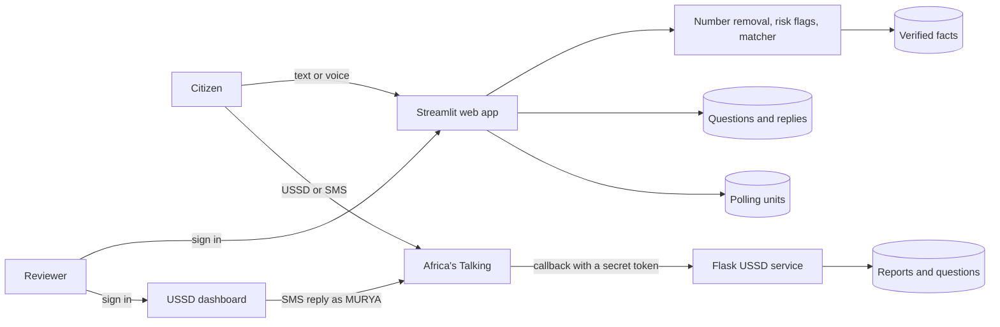

# MURYA architecture

AI4Elections Hackathon 2026–2027 · Track 3 · Version 1.0 · Last updated 3 November 2026

## 1. Overview

MURYA has two services that share one idea: **match a question to an answer a person has already verified, or hand it to a person.**

## 2. Web app (`app.py`, Streamlit)

| Layer | What it holds |
|---|---|
| Interface | Pages: Home, Ask, Verified Info, Polling Units, Learn, Dashboard, Responsible AI, Privacy, Admin, Contact. A language layer (`tx`) gives Hausa, English and Fulfulde text. Large text and high contrast switches. The page and language are kept in the web address so a dropped connection returns to the same place |
| Matching (pure functions) | `norm`, `mtoks`, `kb_match`, `lga_hit`, `risk_flags`, `redact`. No Streamlit calls, so they run offline in tests. Concept matching joins Hausa and English words; a typo corrector reads a close misspelling as the nearest known word; a hand-over happens when nothing fits |
| Data (SQLite, `murya.db`) | `questions`, `kb` (verified facts with English and Fulfulde versions), `polling_units`, `pu_meta`, `audit_log`, `login_attempts` |
| Optional AI | Whisper speech-to-text and an Anthropic draft assistant, both off unless a key is set. Drafts use confirmed facts only and are never sent automatically |
| Voice output | Recorded Hausa and Fulfulde clips (`voice_audio/`), server voice (gTTS) for English, and the phone's own voice as a fallback |
| Security | Admin hash read from secrets, sign-in lockout counted in the database, reviewer names, audit log, 30-day deletion, redaction of numbers before storing |

## 3. USSD/SMS service (`ussd.py`, Flask)

- **Callback:** `POST /murya/<USSD_TOKEN>`. It returns plain text that starts with `CON` (more input) or `END` (finished).
- **Menu:** language, then *Ask a question* (election dates, INEC office for any of the 20 LGAs, photocopy of PVC, how to check a PVC, or a typed question) or *Report a problem* (polling-unit code, issue, description).
- **Reviewer dashboard:** sign-in page with a cookie session, masked phone numbers, reply by SMS from the sender name MURYA, export without phone numbers.
- **Storage:** SQLite (`murya_ussd.db`). Reports and questions are deleted after 30 days.

## 4. Deployment

| Part | Where | Configuration |
|---|---|---|
| Web app | Streamlit Community Cloud | Secrets: `ADMIN_PW_SALT`, `ADMIN_PW_HASH`, optional `OPENAI_API_KEY`, `ANTHROPIC_API_KEY`, `ANTHROPIC_MODEL`, `STT_MODEL`, `RETENTION_DAYS` |
| USSD service | Render (`gunicorn ussd:app --workers 1 --threads 4`) | Environment: `AT_USERNAME`, `AT_API_KEY`, `AT_SENDER_ID`, `ADMIN_USER`, `ADMIN_PASSWORD_HASH`, `USSD_TOKEN`, `SECRET_KEY` |
| USSD and SMS | Africa's Talking simulator | Callback address contains the secret token |

## 5. Design decisions

1. **Retrieval, not generation.** Every answer a citizen sees is approved text, so no answer can be invented. This follows the Track 3 target of zero unsupported answers.
2. **A person approves everything.** AI only transcribes, suggests or drafts.
3. **A pure matching block.** The matching functions have no Streamlit calls, so `compare_retrieval.py` and the self-test can run them on their own.
4. **SQLite.** One file per service keeps the prototype simple. It is wiped by free hosting on restart, so a managed database is the first production step.
5. **Plain ASCII for USSD.** Hooked Hausa letters push phones into a shorter character limit, so every USSD screen is plain ASCII and within 182 characters.
6. **Separate services.** The Flask service has its own sign-in, token and database, so a fault in one cannot expose the other.

## 6. Limits and the path to production

- Free hosting can erase both databases on restart: move to a managed database with backups.
- One reviewer is a bottleneck: add reviewer accounts and shifts.
- The USSD service runs only in the simulator: a live use needs a registered short code and sender ID.
- Streamlit is heavy on 2G: USSD is the low-bandwidth route.
